### Escuela Colombiana de Ingeniería
### Arquitecturas de Software - ARSW

## Escalamiento en Azure con Maquinas Virtuales, Sacale Sets y Service Plans

### Dependencias
* Cree una cuenta gratuita dentro de Azure. Para hacerlo puede guiarse de esta [documentación](https://azure.microsoft.com/es-es/free/students/). Al hacerlo usted contará con $100 USD para gastar durante 12 meses.
Antes de iniciar con el laboratorio, revise la siguiente documentación sobre las [Azure Functions](https://www.c-sharpcorner.com/article/an-overview-of-azure-functions/)

### Parte 0 - Entendiendo el escenario de calidad

Adjunto a este laboratorio usted podrá encontrar una aplicación totalmente desarrollada que tiene como objetivo calcular el enésimo valor de la secuencia de Fibonnaci.

**Escalabilidad**
Cuando un conjunto de usuarios consulta un enésimo número (superior a 1000000) de la secuencia de Fibonacci de forma concurrente y el sistema se encuentra bajo condiciones normales de operación, todas las peticiones deben ser respondidas y el consumo de CPU del sistema no puede superar el 70%.

### Escalabilidad Serverless (Functions)

1. Cree una Function App tal cual como se muestra en las  imagenes.


2. Instale la extensión de **Azure Functions** para Visual Studio Code.


3. Despliegue la Function de Fibonacci a Azure usando Visual Studio Code. La primera vez que lo haga se le va a pedir autenticarse, siga las instrucciones.


4. Dirijase al portal de Azure y pruebe la function.


5. Modifique la coleción de POSTMAN con NEWMAN de tal forma que pueda enviar 10 peticiones concurrentes. Verifique los resultados y presente un informe.

6. Cree una nueva Function que resuleva el problema de Fibonacci pero esta vez utilice un enfoque recursivo con memoization. Pruebe la función varias veces, después no haga nada por al menos 5 minutos. Pruebe la función de nuevo con los valores anteriores. ¿Cuál es el comportamiento?.

**Preguntas**

* ¿Qué es un Azure Function?
* ¿Qué es serverless?
* ¿Qué es el runtime y que implica seleccionarlo al momento de crear el Function App?
* ¿Por qué es necesario crear un Storage Account de la mano de un Function App?
* ¿Cuáles son los tipos de planes para un Function App?, ¿En qué se diferencias?, mencione ventajas y desventajas de cada uno de ellos.
* ¿Por qué la memoization falla o no funciona de forma correcta?
* ¿Cómo funciona el sistema de facturación de las Function App?
* Informe


---

# Desarrollo del laboratorio

**Integrantes:** Nicolás Andrés Parrado · Juan Esteban Hernández Moreno
**Function App:** `fibonacci-parrado-hernandez` — Grupo de recursos `SCALABILITY_LAB_II` — East US 2 — Windows — Plan **Consumo (serverless, SKU Y1)** — Node.js 22 LTS — Functions runtime **v4** (4.1055.x)

## 0. Ajustes previos al proyecto

El proyecto entregado estaba configurado para **Azure Functions v2 con Node.js 12**, que Azure ya no ofrece. Para poder desplegarlo hubo que hacer estos cambios, sin tocar la lógica de `Fibonacci/index.js`:

| Archivo | Cambio | Motivo |
|---|---|---|
| `FunctionProject/host.json` | `extensionBundle.version`: `[1.*, 2.0.0)` → `[4.*, 5.0.0)` | El runtime v4 no admite el bundle 1.x |
| `.vscode/settings.json` | `azureFunctions.projectRuntime`: `~2` → `~4` | Coincide con el runtime de la Function App |
| `.vscode/tasks.json` | La tarea `npm prune` ahora depende de `npm install`, no de `func: extensions install` | Así `big-integer` se empaqueta con la función y el deploy no requiere Azure Functions Core Tools |

## 1. Creación de la Function App

Se creó desde el portal con plan **Consumo (Windows)**, Node.js 22 LTS, una cuenta de almacenamiento nueva (`scalabilitylabiia7af`) y Application Insights habilitado. Azure añade un sufijo único al hostname: `fibonacci-parrado-hernandez-dsfphuhmfehgcabe.eastus2-01.azurewebsites.net`.

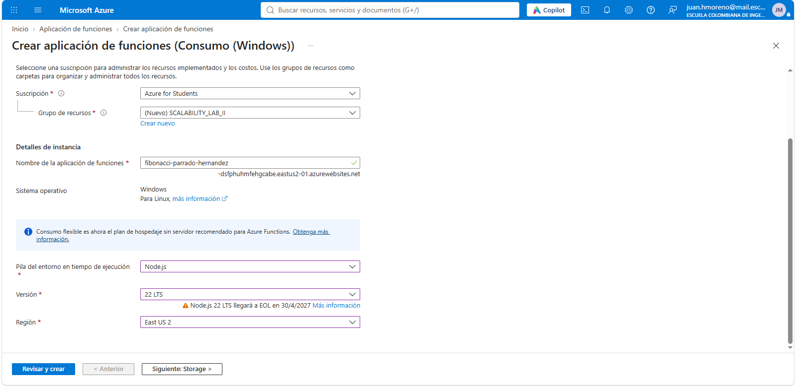
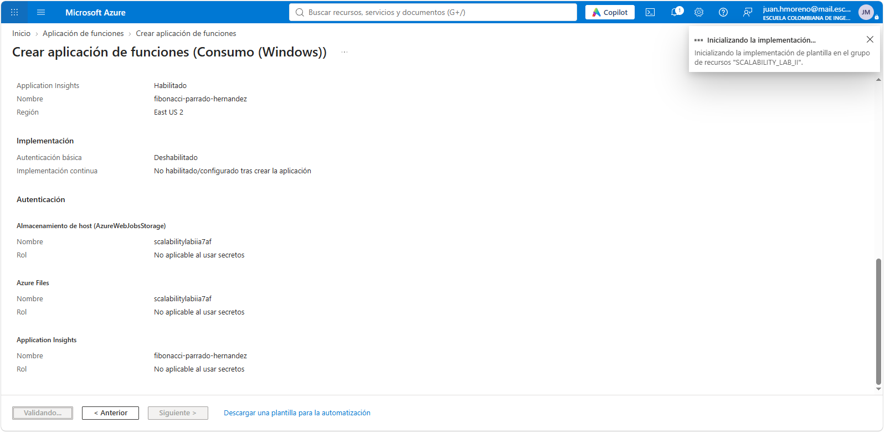
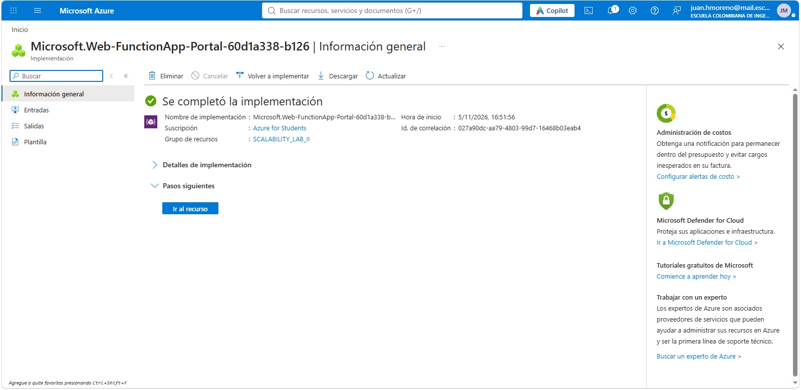
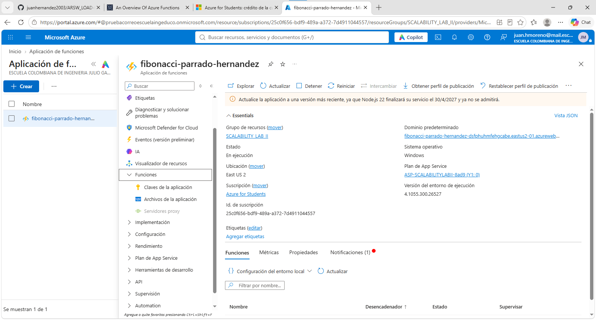

## 2. Extensión de Azure Functions para VS Code

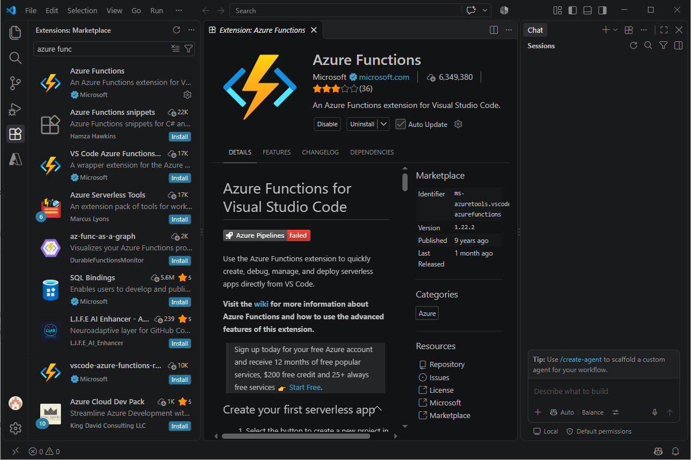

## 3. Despliegue desde VS Code

El despliegue se hizo con *Deploy to Function App...* desde la extensión.

**Problemas encontrados y cómo se resolvieron**

1. **PowerShell bloqueaba `npm`.** El error era `npm.ps1 no se puede cargar porque la ejecución de scripts está deshabilitada`, y por eso falló la tarea previa al deploy. Se resolvió con `Set-ExecutionPolicy -Scope CurrentUser -ExecutionPolicy RemoteSigned`.
   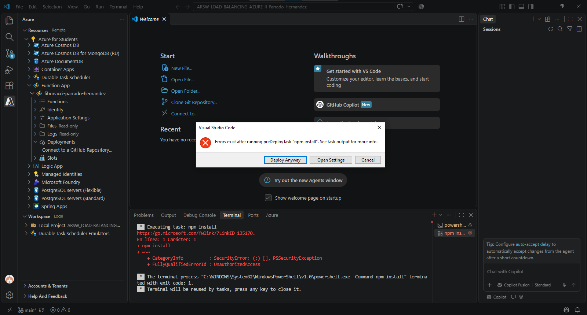
2. **`ServiceUnavailable` en el primer deploy.** El paquete se subió y se compiló bien, pero el host todavía estaba arrancando en frío cuando VS Code intentó sincronizar los triggers. Un segundo deploy terminó con éxito.
   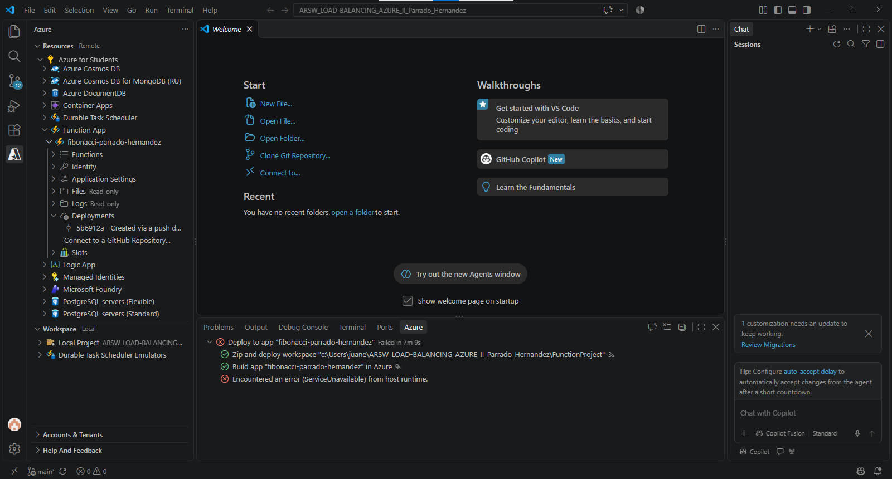
   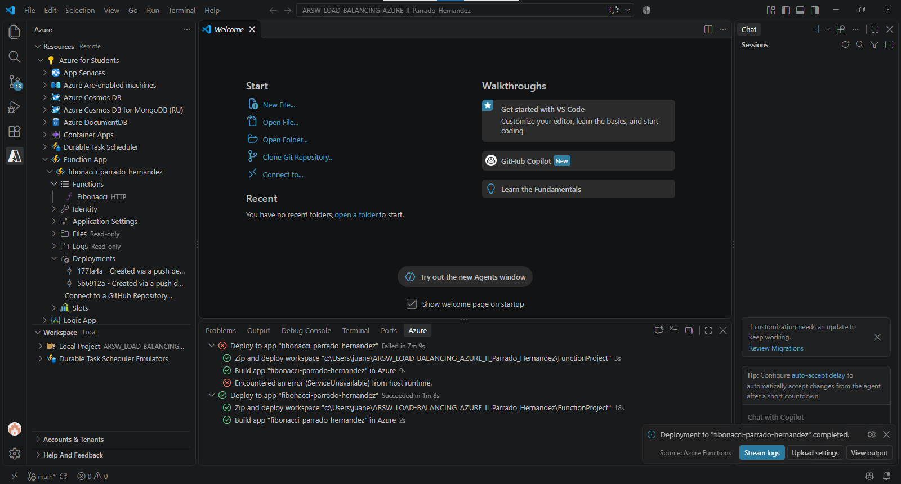

## 4. Prueba de la función en el portal

| Prueba | Resultado | Duración |
|---|---|---|
| POST `{"nth": 10}` | 200 → `55` | 48 ms |
| POST `{"nth": 1000000}` | 200 → número de **208.988 dígitos** | ≈ 12,2 s |

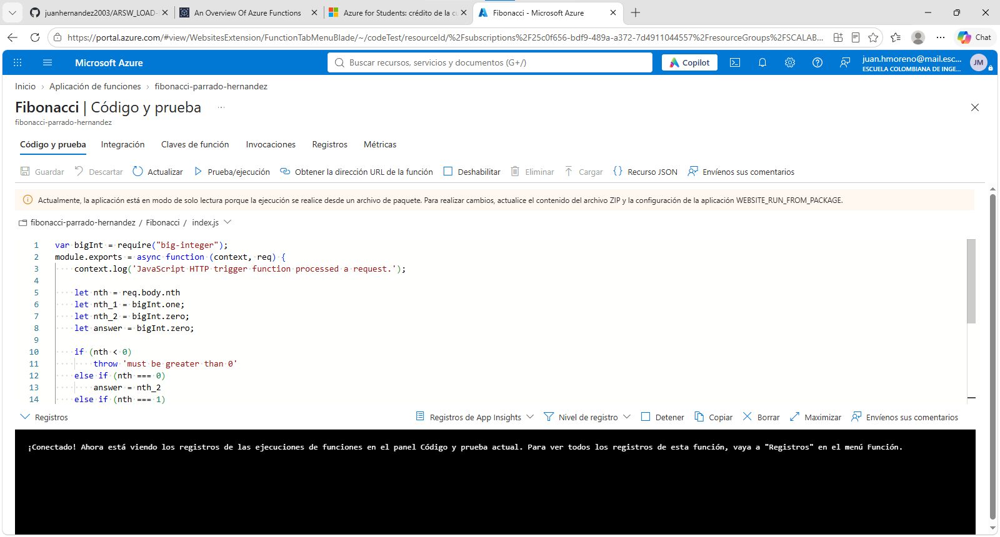
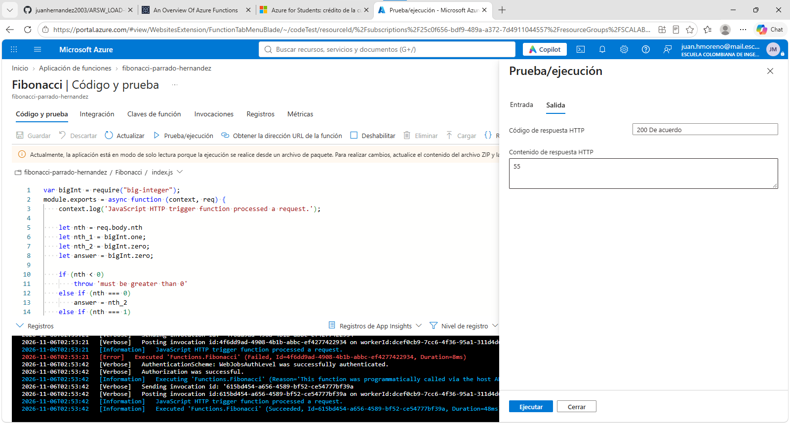
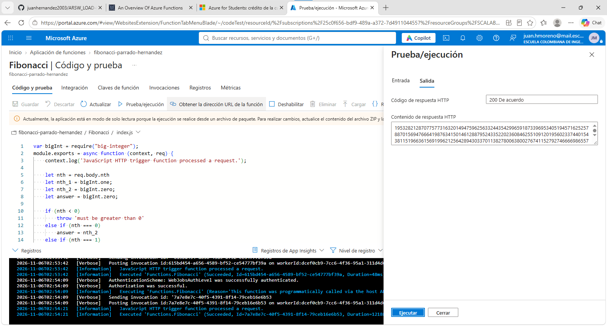

Antes de estas pruebas hubo una ejecución que falló en 8 ms. Se envió sin cuerpo, y la función accede a `req.body.nth` sin validar la entrada.

## 5. Diez peticiones concurrentes con Newman

El repositorio no traía colección, así que se creó en la carpeta [`postman/`](postman/):

- `ARSW_Fibonacci.postman_collection.json`: hace POST a `{{URL}}/api/{{function}}` con el cuerpo `{"nth": {{nth}}}`, y tiene tests que verifican el status 200 y que la respuesta no esté vacía.
- `ARSW_Fibonacci.postman_environment.json`: define la URL de la Function App, `function=Fibonacci` y `nth=1000000`.
- `run-concurrent.ps1`: Newman ejecuta las iteraciones en secuencia, así que el script lanza **10 procesos de Newman en paralelo**. Al terminar consolida los reportes JSON en una tabla, en `summary.csv` y en estadísticas de tiempo.

```powershell
npm install -g newman
cd postman
.\run-concurrent.ps1            # parámetros opcionales: -N 10 -Nth 1000000 -Function Fibonacci
```

### Resultados (nth = 1.000.000)

| Petición | Status | Tiempo (s) |
|---|---|---|
| 1 | 200 | 72,68 |
| 2 | 200 | 51,37 |
| 3 | 200 | 73,58 |
| 4 | 200 | 72,98 |
| 5 | 200 | 50,78 |
| 6 | 200 | 50,70 |
| 7 | 200 | 72,68 |
| 8 | 200 | 72,83 |
| 9 | 200 | 50,89 |
| 10 | 200 | 72,42 |

- **Peticiones exitosas:** 10 de 10. Todas devolvieron los 208.988 dígitos correctos.
- **Tiempo de respuesta:** mínimo 50,7 s · promedio 64,1 s · máximo 73,6 s.
- **Tiempo total de reloj** para las 10 peticiones: 80,8 s.

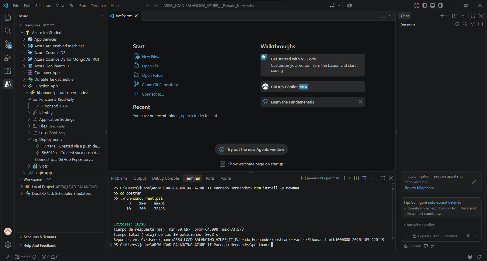

### Análisis

Los tiempos no se reparten al azar. Forman **dos grupos exactos**:

- **4 peticiones** terminaron hacia los 51 s, lo que equivale a unas 4 × 12,7 s.
- **6 peticiones** terminaron hacia los 73 s, lo que equivale a unas 6 × 12,1 s.

La consulta en Application Insights lo confirma:

```kusto
requests
| where timestamp > ago(2h) and name == "Fibonacci"
| summarize peticiones = count(), duracion_prom_s = avg(duration)/1000 by cloud_RoleInstance
```

| Instancia | Peticiones | Duración promedio |
|---|---|---|
| `6b2a3e…` | 4 | 50,4 s |
| `ed6ffb…` | 10 (6 de Newman + las pruebas del portal) | 44,7 s |

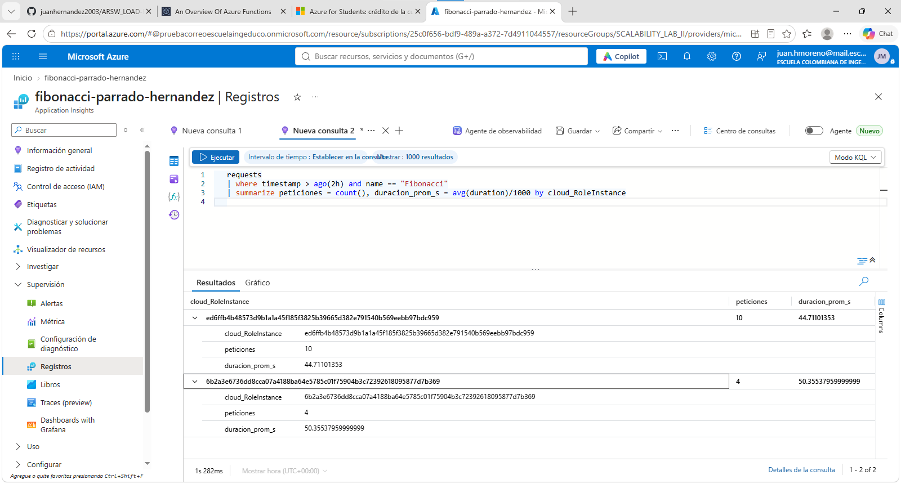

**Interpretación**

1. **El plan Consumo sí escaló a lo ancho.** Al recibir 10 peticiones simultáneas pasó de 1 a **2 instancias**, sin que configuráramos nada.
2. **Dentro de cada instancia, las peticiones se atendieron en serie.** El worker de Node.js tiene un solo hilo, y el bucle de `BigInteger` es síncrono, CPU-bound y sin `await`, así que bloquea el event loop mientras calcula. Cada instancia procesó su cola una petición tras otra, y por eso los tiempos son múltiplos de unos 12 s.
3. **El escalado no es inmediato ni de una instancia por petición.** El controlador de escalado decide según la tasa de eventos y añade instancias de forma gradual, no según el uso de CPU. El ideal, con 10 instancias, habría sido unos 12 s por petición. Se obtuvo un promedio de 64 s.

**Frente al escenario de calidad**

- *"Todas las peticiones deben ser respondidas"*: **se cumple**, 10 de 10 respondieron 200.
- *"El consumo de CPU no puede superar el 70 %"*: **no se cumple ni se puede garantizar.** En plan Consumo no hay control sobre la CPU por instancia. Mientras calcula, cada instancia ocupa por completo un núcleo con el único hilo de Node, y la plataforma no escala por umbral de CPU.
- Además, **la latencia crece 4 a 6 veces** con solo 10 usuarios concurrentes. Para cumplir el escenario habría que usar un plan **Premium o Flex Consumption** con instancias siempre listas y más núcleos (y `FUNCTIONS_WORKER_PROCESS_COUNT` > 1), o sacar el cálculo del hilo principal con `worker_threads`.

## 6. Fibonacci recursivo con memoization

Se creó la función [`FunctionProject/FibonacciMemo`](FunctionProject/FibonacciMemo/index.js). Usa un enfoque **top-down**: `fib(n) = fib(n-1) + fib(n-2)`, guardando los resultados en un `Map` declarado **a nivel de módulo**. Así el memo se conserva entre invocaciones mientras siga viva la misma instancia del worker.

La respuesta es un JSON con estos campos, para observar el comportamiento del caché:

- `fromCache`: indica si el resultado salió del memo.
- `memoSizeBefore` y `memoSizeAfter`: tamaño del memo antes y después del cálculo.
- `elapsedMs`: tiempo de cálculo.
- `instanceId`, `pid`, `loadedAt`, `uptimeSec` e `invocationsOnThisInstance`: identifican la instancia y su historia.

También devuelve 400 si `nth` no es válido, y 500 con el detalle del error si el cálculo falla.

### Primera ronda (2026-11-06, hora UTC)

| Hora | nth | Resultado | Memo | Tiempo |
|---|---|---|---|---|
| 03:15:21 | 15000 | **500 – `RangeError: Maximum call stack size exceeded`** | 2 (vacío) | — |
| 03:15:42 | 7000 | 200, `fromCache=false` | 2 → 7001 | 10,11 ms |
| 03:15:58 | 14000 | 200, `fromCache=false` | 7001 → 14001 | 17,87 ms |
| 03:16:13 | 20000 | 200, `fromCache=false` | 14001 → 20001 | 12,58 ms |
| 03:16:28 | 7000 | 200, **`fromCache=true`** | 20001 | **0,00 ms** |
| 03:16:42 | 1000000 | **500 – `RangeError: Maximum call stack size exceeded`** | 20001 | — |

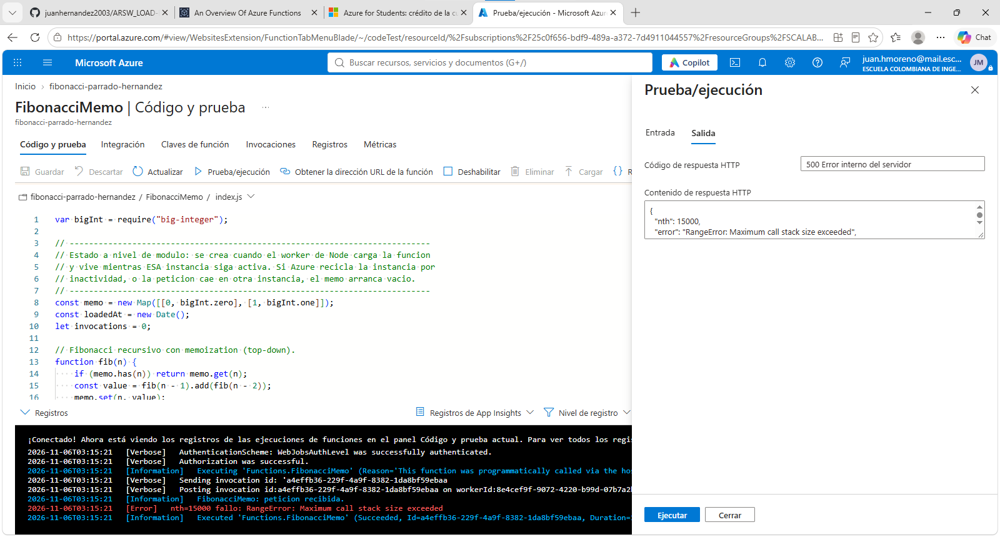
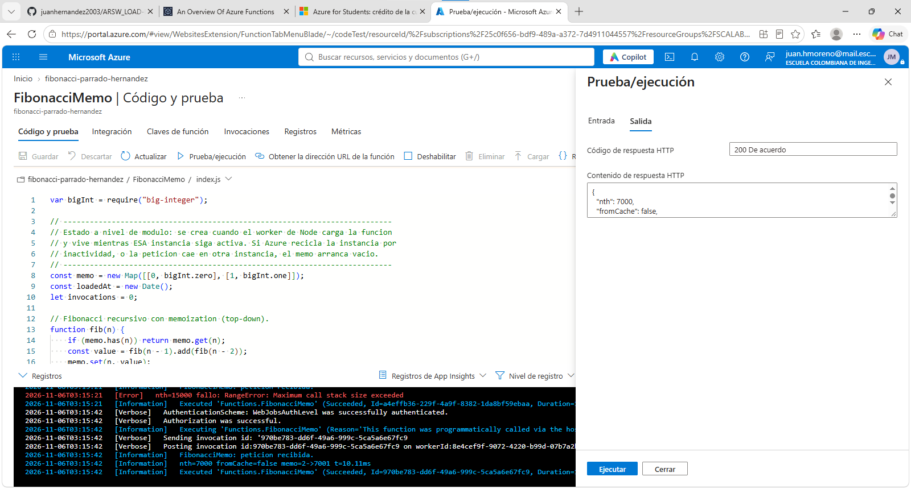


### Segunda ronda, tras unos 7 minutos sin actividad

| Hora | nth | Resultado | Memo | Instancia |
|---|---|---|---|---|
| 03:23:36 | 20000 | 200, `fromCache=true`, 0,001 ms | 20001 | `ed6ffb4b4857`, `uptimeSec=609`, invocación n.º 7 |
| 03:23:59 | 7000 | 200, `fromCache=true`, 0,001 ms | 20001 | `ed6ffb4b4857`, `uptimeSec=632`, invocación n.º 8 |

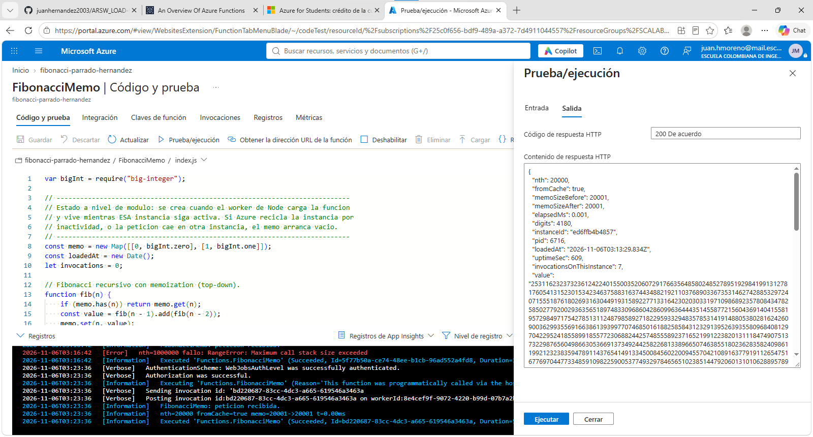


### Tercera ronda, tras unos 16 minutos sin actividad

| Hora | nth | Resultado | Memo | Instancia |
|---|---|---|---|---|
| 03:40:18 | 20000 | 200, `fromCache=true`, 0,001 ms | 20001 | `ed6ffb4b4857`, `uptimeSec=1611`, invocación n.º 9 |


### ¿Cuál es el comportamiento?

- **Mientras la instancia está viva, la memoization funciona.** Las consultas repetidas responden en unos 0 ms. Además, "calentar" el memo por tramos permite calcular valores (14000, 20000) que con el memo vacío desbordan la pila: la misma petición `nth=15000` falló al principio y habría funcionado después.
- **Tras unos 7 minutos, y después tras unos 16 minutos de inactividad, la instancia `ed6ffb…` seguía viva.** Es la misma que atendió 6 de las peticiones de Newman: `loadedAt` 03:13:29Z y `uptimeSec` de 609 s y luego de 1611 s, unos 27 minutos de vida. Por eso el memo se conservó en las tres rondas. Hay un factor que pudo influir: durante la espera el panel *Código y prueba* del portal siguió abierto, y su flujo de registros mantiene una conexión con el host que puede retrasar la desasignación. La plataforma **no garantiza** cuándo desasigna una instancia inactiva. Puede mantenerla varios minutos más o reciclarla, y en ese caso el memo se pierde: `20000` volvería a fallar por desbordamiento de pila y todo se recalcularía desde cero. Que el caché sobreviva o no depende de la plataforma, no de nuestro código.
- **`nth = 1.000.000` siempre falla.** Haría falta una profundidad de recursión de un millón de llamadas, y la pila de Node.js se agota alrededor de las 9.000.

---

# Preguntas

### ¿Qué es un Azure Function?
Es el servicio de cómputo **serverless y orientado a eventos** de Azure. Se escriben funciones pequeñas, y cada una se ejecuta cuando ocurre un **trigger**: una petición HTTP, un mensaje en una cola, un blob nuevo, un temporizador, un evento de Event Grid, etc. Los **bindings** declarativos de entrada y salida conectan la función con otros servicios sin escribir código de integración. Varias funciones se agrupan en una **Function App**, que es la unidad de despliegue, configuración y escalado. En este laboratorio, `Fibonacci` y `FibonacciMemo` son dos funciones con trigger HTTP dentro de la Function App `fibonacci-parrado-hernandez`.

### ¿Qué es serverless?
Es un modelo de ejecución en la nube donde **el proveedor administra toda la infraestructura**: servidores, sistema operativo, parches, runtime, balanceo y escalado. El desarrollador solo entrega código. Sus características principales son:

- **Escalado automático y elástico**, incluso a cero instancias cuando no hay tráfico.
- **Pago por uso**: se paga por ejecución y por tiempo-memoria consumido, no por tener un servidor encendido.
- **Arquitectura orientada a eventos y sin estado.**

"Serverless" no significa que no haya servidores, sino que no los ves ni los gestionas. Las contrapartes son el **cold start**, los **límites de tiempo de ejecución** y la ausencia de **estado local confiable**. Esa última es la causa de lo observado con la memoization.

### ¿Qué es el runtime y qué implica seleccionarlo al crear la Function App?
Hay dos piezas:

- **Runtime de Functions (host).** La versión del motor de Azure Functions (v1, v2, v3, v4) que carga las funciones, gestiona triggers y bindings, y se comunica con el worker del lenguaje. Hoy solo v4 tiene soporte.
- **Pila del entorno de ejecución (runtime stack).** El lenguaje y su versión (Node.js 22, .NET 8, Python 3.12, Java 21...), que corre en un *language worker*.

Seleccionarlos implica:

- **Qué código se puede desplegar y con qué modelo de programación.** Por ejemplo, `function.json` y `module.exports` es el modelo v3 de Node, que v4 sigue admitiendo.
- **Qué versiones del extension bundle son compatibles.** Tuvimos que pasar de 1.x a 4.x.
- **Sistemas operativos y planes disponibles.** Algunas pilas solo corren en Linux o tienen restricciones por plan.
- **Ciclo de vida y soporte.** El portal ya avisa que Node.js 22 deja de tener soporte el 30/04/2027, y este laboratorio estaba escrito para Node 12 y runtime ~2, que ya no se pueden crear.
- **El lenguaje no se puede cambiar fácilmente después.** El stack queda ligado a la app; para cambiar de lenguaje normalmente se crea otra Function App.

### ¿Por qué es necesario crear un Storage Account junto con una Function App?
El host de Functions depende de una cuenta de almacenamiento de uso general (`AzureWebJobsStorage`) para operar:

- **Blobs:** guardan las **claves de las funciones**, los *leases* de coordinación entre instancias y, con *run from package*, el **paquete ZIP del código** (`WEBSITE_RUN_FROM_PACKAGE`).
- **Colas y tablas:** se usan para la gestión interna de triggers, el reparto de eventos entre instancias, los reintentos, el estado de los timers (para que se ejecuten en una sola instancia) y el estado de Durable Functions.
- **Azure Files:** en los planes Consumo y Premium sobre Windows, guarda el **contenido de la app** compartido por todas las instancias. En nuestra app, la cuenta `scalabilitylabiia7af` cumple ese rol.

Como las instancias serverless son efímeras y pueden ser muchas, necesitan un **almacenamiento externo compartido** para coordinarse y persistir. Sin él, el host no arranca.

### ¿Cuáles son los tipos de planes para una Function App? ¿En qué se diferencian? Ventajas y desventajas

| Plan | Cómo funciona | Ventajas | Desventajas |
|---|---|---|---|
| **Consumo** (el usado: Y1, Windows) | Escala automáticamente de 0 a N instancias según los eventos. Se paga por ejecución y por GB-s. | Costo cero sin tráfico. Generosa cuota gratuita mensual. Nada que administrar. | **Cold start.** Timeout de 5 min por defecto y 10 máx. (las HTTP, 230 s). ~1,5 GB de memoria por instancia. Sin VNet. Escalado gradual. Microsoft ya lo considera *legacy*: recomienda Flex Consumption y anunció el retiro del Consumo en Linux. |
| **Flex Consumption** (el recomendado hoy) | Serverless con escalado por función, tamaño de instancia configurable (512 MB / 2 GB / 4 GB) e instancias **always ready** opcionales. | Mantiene el pago por uso y reduce o elimina el cold start con *always ready*. Integración con VNet. Escala a muchas más instancias. Más concurrencia por instancia. | Solo Linux. Las instancias *always ready* tienen un costo base. Su cuota gratuita es menor que la de Consumo. Es más nuevo. |
| **Premium** (Elastic Premium EP1–EP3) | Instancias **precalentadas**, siempre al menos 1 activa. Escala elásticamente sobre esa base. | Sin cold start. Ejecuciones largas (sin límite práctico). Más CPU y memoria por instancia. VNet y enlaces privados. | Pago fijo por vCPU y memoria asignados por segundo, **aunque no haya tráfico**. Más caro para cargas pequeñas o esporádicas. |
| **Dedicado** (App Service Plan) | Las funciones corren en las VMs de un plan de App Service que ya pagas. | Costo predecible. Reutiliza capacidad ociosa de otras apps. Sin límite de tiempo (con *Always On*). | No es serverless: se paga 24/7. El escalado es manual o por reglas de autoescalado, menos elástico. |
| **Container Apps** | Functions empaquetadas como contenedor en Azure Container Apps. | Contenedores personalizados, junto a microservicios. Escalado con KEDA. | Más complejidad operativa. Pensado para escenarios con contenedores. |

### ¿Por qué la memoization falla o no funciona de forma correcta?
1. **El estado vive en la memoria de una instancia efímera.** El memo es un `Map` en la memoria del proceso. Se pierde cuando la plataforma **recicla la instancia** por inactividad, o con cada **reinicio o nuevo despliegue**. En serverless las funciones se deben diseñar **sin estado**: el estado en memoria es, como mucho, un caché oportunista.
2. **No se comparte entre instancias.** Con el escalado horizontal que vimos en el punto 5 (2 instancias), cada instancia tiene **su propio memo**. Una petición puede caer en la instancia "caliente" y responder en 0 ms, y la siguiente caer en una instancia nueva con el memo vacío, recalcular todo o incluso fallar. El comportamiento deja de ser predecible.
3. **La recursión desborda la pila.** El enfoque top-down necesita una profundidad de recursión igual a `n` cuando el memo está vacío. La pila de Node.js admite unos 9.000 marcos, así que con el memo frío `nth=15000` falla, y `nth=1.000.000` falla siempre (`RangeError: Maximum call stack size exceeded`).
4. **La memoria tampoco alcanzaría para `n` grandes.** Guardar F(0) a F(1.000.000) implica almacenar unos 0,209·Σk ≈ **1×10¹¹ dígitos**. Con la representación de `big-integer` (base 10⁷ en números de 8 bytes), eso son unos **120 GB**, muy por encima del ~1,5 GB que permite una instancia del plan Consumo.

**Cómo se resolvería:** usar el algoritmo **iterativo**, que es O(n) en tiempo y O(1) en memoria, como la función original. Si de verdad se necesita reutilizar resultados, guardarlos en un **caché externo compartido** (Azure Cache for Redis, Table Storage o Durable Entities), y solo para los valores consultados, no para toda la secuencia.

### ¿Cómo funciona el sistema de facturación de las Function App?
Depende del plan:

- **Consumo.** Se cobra por dos conceptos:
  - **Tiempo de ejecución** en **GB-s**: la memoria usada, redondeada al múltiplo de 128 MB superior, por la duración de la ejecución, con un mínimo de 100 ms. Precio de lista de USD 0,000016/GB-s.
  - **Número de ejecuciones**: USD 0,20 por millón.
  - Cada suscripción tiene una **cuota gratuita mensual de 400.000 GB-s y 1 millón de ejecuciones**. Sin tráfico, el costo es USD 0.
- **Flex Consumption.** Cobra *on demand* por GB-s y ejecuciones, con una cuota gratuita de 100.000 GB-s y 250.000 ejecuciones al mes. Si se configuran instancias *always ready*, se paga además una línea base por su memoria.
- **Premium y Dedicado.** Se paga por la capacidad asignada (vCPU y memoria por segundo, o la tarifa de la VM del App Service Plan), **independientemente del número de ejecuciones**.
- **En todos los planes** se facturan aparte la **cuenta de Storage**, **Application Insights** (con su propia cuota gratuita de telemetría) y el **ancho de banda** de salida.

**Estimación para este laboratorio.** La prueba de Newman sumó unos 637 s de ejecución: 4 × 50,4 + 6 × 72,5. El tiempo que una invocación espera en cola dentro del worker cuenta como ejecución, porque el host mide desde que la entrega hasta que recibe la respuesta. Asumiendo unos 256 MB por ejecución, son unos 160 GB-s, menos del 0,05 % de la cuota gratuita mensual. Sin la cuota, costaría unos USD 0,003.

---

# Informe

**Objetivo.** Evaluar si una arquitectura **serverless** (Azure Functions, plan Consumo) cumple el escenario de escalabilidad: *con usuarios concurrentes pidiendo el n-ésimo Fibonacci (n ≥ 1.000.000), todas las peticiones deben responderse y la CPU no debe superar el 70 %.*

**Resumen de resultados**

| Métrica | Valor |
|---|---|
| Una petición `nth=1.000.000` (portal) | ≈ 12,2 s, 200 OK, 208.988 dígitos |
| 10 peticiones concurrentes (Newman) | **10/10 exitosas** |
| Tiempo de respuesta con 10 concurrentes | mín. 50,7 s · prom. 64,1 s · máx. 73,6 s |
| Tiempo total de reloj | 80,8 s |
| Instancias usadas (Application Insights) | 2 (4 y 6 peticiones respectivamente) |
| Memoization, misma instancia | consulta repetida en ~0 ms; el memo sobrevivió 7 y 16 min de inactividad (instancia viva unos 27 min) |
| Memoization, memo vacío | `nth ≥ ~9.000` → 500 por desbordamiento de pila; `nth=1.000.000` falla siempre |

**Conclusiones**

1. **Disponibilidad: se cumple.** El plan Consumo absorbió la carga sin errores y escaló de forma automática de 1 a 2 instancias, sin configurar reglas ni pagar por capacidad ociosa.
2. **Rendimiento y CPU: no se cumple.** El cálculo es CPU-bound y Node.js ejecuta el código de la función en un solo hilo. Por eso, en cada instancia las peticiones se encolaron y se atendieron en serie, y la latencia se multiplicó entre 4 y 6 veces. En Consumo no se puede limitar ni elegir la CPU, y el escalado responde a la tasa de eventos, no a un umbral de CPU. Además, el escalado es gradual: con 10 peticiones no se crearon 10 instancias.
3. **Serverless exige diseñar sin estado.** La memoization en memoria es frágil: depende de la vida de una instancia que la plataforma controla, no se comparte entre instancias y, con recursión, se topa con el límite de pila. En este caso el algoritmo iterativo de la función original es la solución correcta, y si hace falta un caché, debe ser externo (Redis o Storage).
4. **Costo.** Toda la práctica cupo holgadamente en la cuota gratuita. El modelo de pago por uso es ideal para cargas esporádicas como esta. Para cumplir el escenario de calidad con latencias bajas convendría **Flex Consumption o Premium**, con instancias *always ready* y más núcleos o varios procesos worker. Esto se cambia por un costo base fijo.

**Reproducir las pruebas de carga**

```powershell
cd postman
.\run-concurrent.ps1                                   # Fibonacci iterativo, 10 concurrentes, nth=1000000
.\run-concurrent.ps1 -Function FibonacciMemo -Nth 7000 # versión con memoization
```
